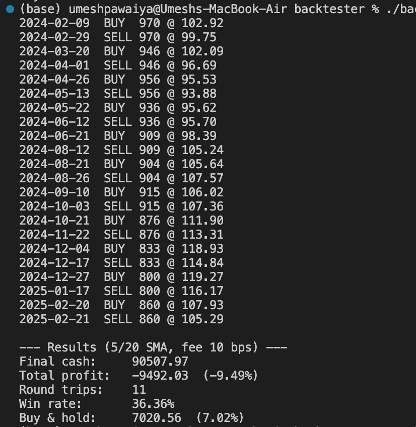

# 📈 Moving Average Crossover Backtester

A fast, lightweight C++ backtester that simulates a Simple Moving Average (SMA) crossover trading strategy on stock price data.

---

## ⚡ How It Works

- **BUY:** Short SMA crosses **above** long SMA (Bullish Golden Cross).
- **SELL:** Short SMA crosses **below** long SMA (Bearish Death Cross).
- **Realistic:** Accounts for trading fees (10 bps / 0.10%) and compares returns against a **Buy & Hold** benchmark.
- **Precise:** Uses integer cents (`long long`) to eliminate floating-point rounding errors.

---

## 🚀 Quickstart

### 1. Compile
```bash
g++ -std=c++17 -O2 backtest.cpp -o backtest
```

### 2. Run
```bash
# Run with default 5-day / 20-day SMA
./backtest TSLA.csv

# Or specify custom windows: ./backtest <file.csv> [shortWindow] [longWindow]
./backtest TSLA.csv 5 20
```

---

## 📊 Results

### Trade Execution & Summary
Outputs every trade signal (date, price, shares) and final performance metrics:



### Benchmark Comparison
Summary of strategy returns, win rate, and total round trips vs. holding the stock:


