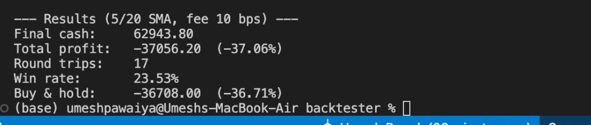

# C++ Moving Average Crossover Backtester 📈

A fast, lightweight, dependency-free algorithmic trading backtester written in modern C++ (C++17). It simulates a Moving Average Crossover strategy on historical stock price data with realistic transaction fee modeling and fixed-point currency precision.

---

## ✨ Features

- **Zero External Dependencies**: Implemented cleanly in single-file standard C++17 (`backtest.cpp`).
- **Precision Financial Accounting**: Cash and prices are calculated in integer cents (`long long`) to eliminate floating-point rounding errors.
- **Realistic Transaction Costs**: Simulates exchange/brokerage fees per trade (default: 10 basis points / 0.10%).
- **Flexible CSV Parser**: Handles standard `date,close` formats as well as Yahoo Finance downloads (handles quotes, commas in numbers, and auto-sorts chronological dates).
- **Benchmark Comparison**: Benchmarks strategy returns against a standard **Buy & Hold** baseline over the same testing period.
- **Detailed Trade Metrics**: Computes Total Net Profit/Loss (P&L), Percentage Return, Total Round Trips, and Win Rate.

---

## 📊 Strategy Overview

The strategy implements a classic **Dual Moving Average Crossover**:
- **BUY (Go Long)**: When the short-term Simple Moving Average (SMA) crosses **above** the long-term SMA (Bullish Golden Cross).
- **SELL (Exit to Cash)**: When the short-term SMA crosses **below** the long-term SMA (Bearish Death Cross).
- **Execution**: All-in, long-only positions, exiting completely on sell signals or at the end of the test period.

---

## 🛠️ Build and Run

### Prerequisites
A C++ compiler supporting C++17 (e.g., `g++` or `clang++`).

### 1. Compile
```bash
g++ -std=c++17 -O2 backtest.cpp -o backtest
```

### 2. Run
```bash
./backtest <path_to_csv> [shortWindow] [longWindow]
```

#### Examples:
Run with default 5-day / 20-day SMA:
```bash
./backtest prices.csv
```

Run with custom moving average windows (e.g., 5-day and 20-day on TSLA data):
```bash
./backtest TSLA.csv 5 20
```

---

## 📸 Backtest Results & Output

Here are sample execution runs demonstrating the trade logs and performance summary:

### 1. Trade Execution Logs & Performance Summary
Shows historical buy/sell trigger dates, executed share quantities, and final summary metrics:


### 2. Strategy Metrics vs. Benchmark
Summary metrics comparing the SMA strategy against the Buy & Hold benchmark:



---

## 📁 Repository Structure

```text
├── backtest.cpp            # Core backtester source code
├── prices.csv              # Sample daily price data
├── TSLA.csv                # Sample TSLA historical price data
├── assets/                 # Screenshots and result images
│   ├── trade_logs_and_results.png
│   └── backtest_summary.png
├── .gitignore              # Ignores compiled binaries and system files
└── README.md               # Project documentation
```

---

## 📜 License
Open-source under the [MIT License](LICENSE).
